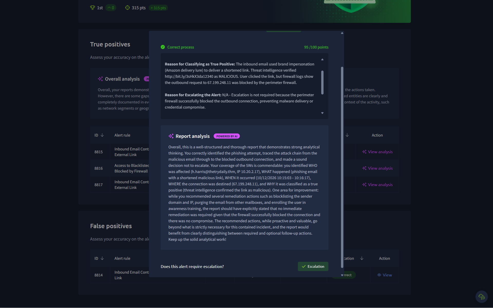
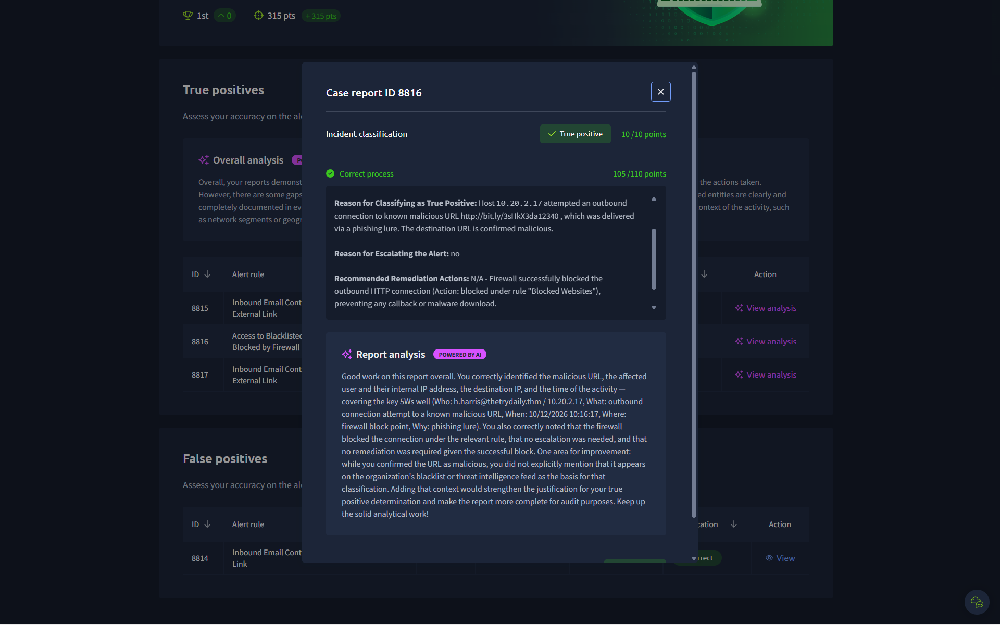
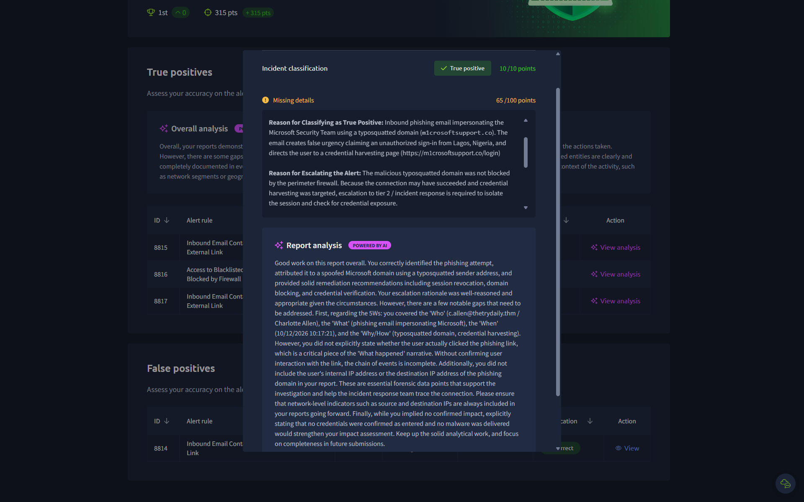

# Security Operations Center (SOC) Investigation: Introduction to Phishing

## Overview
- **Platform:** TryHackMe
- **Lab:** SOC Simulator
- **Category:** Security Operations / Incident Investigation
- **Difficulty:** Easy
- **Status:** Completed
- **Objective:** Practice investigating security alerts, analyzing suspicious activity, and documenting incident findings.

## Skills Demonstrated
- Security alert triage
- Log analysis
- Incident investigation
- Threat identification
- Incident response recommendations

## Investigation Methodology
1. Reviewed the available security alert and supporting evidence.
2. Investigated relevant logs and indicators (Email logs, Perimeter Firewall logs).
3. Assessed the suspicious activity and its potential impact.
4. Documented findings and recommended appropriate response actions.

## Findings
- **Alert investigated:** Inbound Email Containing Suspicious External Link and Firewall Blocked Access (Alerts 8814–8817).
- **Evidence analyzed:**
  - **Alert 8814:** Inbound email flagged for a suspicious external link, evaluated as a benign administrative notification (False Positive).
  - **Alert 8815:** Phishing email utilizing an Amazon delivery lure received by user `h.harris@thedrydaily.thm` (IP: 10.20.2.17) containing a malicious shortened link (`http://bit.ly/3sHKx3da1234`).
  - **Alert 8816:** Perimeter firewall logs showing a blocked outbound connection request from host 10.20.2.17 to IP 67.199.248.11 attempting to reach the malicious URL.
  - **Alert 8817:** Associated inbound phishing email validation in the campaign queue.
- **Assessment:** The investigation correlated an inbound phishing email received by `h.harris` with a user click action that triggered an outbound connection. The perimeter firewall successfully intercepted and blocked the traffic destined for the malicious infrastructure, preventing compromise. Alert 8814 was validated as a false positive requiring detection rule tuning. **Verdict: Mixed** (Alert 8814: False Positive; Alerts 8815–8817: True Positive – Successfully Blocked).
- **Recommended action:** Tune the email filter rules to account for safe external links. Maintain perimeter firewall blocks for malicious domains and IPs (67.199.248.11), purge the phishing email from the recipient's mailbox, and provide targeted phishing awareness training to the affected user.

## Key Takeaways
Successfully analyzed a phishing attack chain from initial email delivery to user interaction and perimeter defense blocking. Learned to differentiate between true threats and false positive alerts to avoid alert fatigue.

## Evidence
See the screenshots included in this repository, with sensitive information removed.
**Overall Analysis Summary:**
.png)

**Alert 8815 - Phishing Email Delivery:**

**Alert 8816 - Perimeter Firewall Block:**

**Alert 8817 - Campaign Verification:**

## Disclaimer
This project documents my personal learning experience in an authorized TryHackMe lab environment. All findings are based on the work I actually performed.
